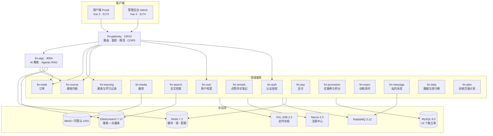
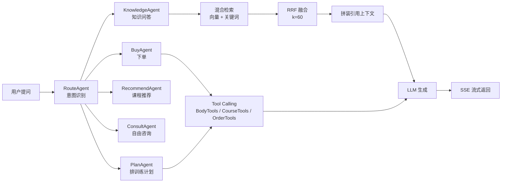

# FitMind · AI 智能健身平台

> 一个微服务拆分的健身训练平台，核心是 **AI 教练** —— 它不只是回答问题，还能查知识库、排训练计划、直接下单。

Java 17 · Spring Boot 3.3 · Spring Cloud Alibaba · Spring AI · Vue 3 · MySQL · Redis · Elasticsearch

---

## 项目概览

大多数健身 App 的做法是：给你一份课表、一个打卡按钮，剩下靠自律。FitMind 想补上缺的那一环——**"有人带"**。

AI 教练被做成一条完整闭环：用户问一句话，系统判断意图（问知识 / 要计划 / 要推荐 / 问课程 / 想下单），交给对应的专职 Agent，该查资料的查资料，该调工具的调工具，最后流式返回答案。**下单是真落库的**，不是只算个价。

| 维度 | 规模 |
|---|---|
| 业务服务 | 16 个（网关 + 15 个领域服务） |
| 独立数据库 | 15 个（一服务一库，无跨库事务） |
| Java 源文件 | 787 个（src/main 下） |
| 前端页面 | 49 个（用户端 34 + 管理后台 15） |
| 端到端验收脚本 | 38 个 |

---

## 核心能力

| 能力 | 说明 |
|---|---|
| **AI 教练多 Agent 路由** | 先由 RouteAgent 判断意图，再分派给知识 / 计划 / 推荐 / 咨询 / 下单 5 个专职 Agent |
| **Agentic RAG** | 向量 + 关键词双路召回 → RRF 融合 → cross-encoder 重排；带相似度阈值与元数据过滤，宁可拒答不编答案 |
| **AI 下单** | Tool Calling 打通 `预下单 → 确认下单`，订单真实写入 `fm_trade`；支付仍需用户本人完成 |
| **双层记忆** | Redis 存会话历史 + 独立上下文窗口，超长自动压缩，压缩失败有兜底 |
| **流式与打断** | SSE 流式输出；分布式打断标记（Redis），点一次停止只中断当前轮，不误伤后续对话 |
| **配额限流** | Redis Lua 原子计数的每日 token 配额，超限降级而非报错 |
| **断点续传 + 秒传** | 三段式 `init → 逐片上传 → complete`，按文件哈希秒传，支持 MinIO 与阿里云 OSS 双后端 |
| **训练与饮食计划** | 计划编排 + 每日打卡 + 完成度统计，饮食按目标与热量缺口生成 |
| **互动与积分** | 点赞 / 评论 / 笔记、积分明细、排行榜（Redis ZSet），赛季到期自动滚动 |

---

## 架构



---

## AI 教练：从一句话到一次下单



### 检索做了什么

知识库是 12 篇训练科学文档（Markdown，约 4.3 万字），切块 600 字、重叠 120 字，用 `text-embedding-v4`（1024 维）写入 Elasticsearch。

检索侧有五层处理：

1. **用真实问题检索** —— 不是空查询扫描全库，避免把整个知识库塞进 prompt
2. **相似度阈值** —— 低于阈值的结果不送进模型。知识库里没有相关内容时，宁可让模型说"不知道"，也不要让它拿着 4 条最不相关的片段硬编
3. **元数据过滤** —— 按用户训练目标过滤，减脂用户拿不到增肌饮食文档
4. **双路召回 + RRF** —— 向量召回 8 条、关键词召回 6 条，用 RRF（`score = Σ 1/(60+rank)`）融合后裁到 4 条。纯向量在精确术语（"臀桥"、"RPE 8"）上会漏，而 ES 本身就是全文检索引擎
5. **cross-encoder 重排** —— 融合后的候选送 `gte-rerank-v2` 重新打分再取前 4 条。RRF 只认名次、不认内容，语料一多"字面像但没用"的块就会挤掉真正相关的

### 为什么用 RRF 而不是加权平均

两路分数根本不可比：余弦相似度在 0–1 之间，BM25 是无上界的对数分值。加权平均要先做归一化，而归一化本身就会引入偏差。RRF 只用**排名**，天然免疫量纲问题，代价只是多一次查询。

### 为什么 RRF 之后还要重排

RRF 有个盲区：它只用**名次**，不知道这块内容到底答不答得上问题。语料只有 1.4 万字时这不算问题——一个主题基本只有一篇文档在讲；扩到 4.3 万字、155 块之后，"字面很像"的块明显变多，实测上下文精度从 **0.89 掉到 0.75**，而 docId 命中率仍是 **100%**。

也就是说：**不是漏了文档，是名额被"像但没用"的块占满了**。这种问题调 topK 治不好——加大名额只会放进更多噪声——只能加一层真正读内容的判别。

用的是百炼现成的 `gte-rerank-v2`（一次调用约 0.005 元、200 ms 级），没有自己训模型。代价是多了个外部依赖，所以硬性设计是**失败必须降级**：重排超时或报错就按 RRF 原顺序返回，绝不因为这一层把检索搞挂。送进去前截断到 1200 字——够判断主题，又不白烧 token。

### 下单为什么敢真落库

`OrderTools` 走的是 `预下单 → 用户确认 → 正式下单` 两段式。模型只能生成预下单，最终那一笔必须用户显式确认；幂等靠唯一索引兜底而不是靠模型听话。支付环节完全交给用户，AI 不碰钱。

---

## 技术栈

| 层 | 选型 |
|---|---|
| 语言 / 运行时 | Java 17 |
| 框架 | Spring Boot 3.3.5 · Spring Cloud 2023.0.3 · Spring Cloud Alibaba 2023.0.3.2 |
| AI | Spring AI 1.1.8（`fm-aigc` 独立版本线）· DeepSeek Chat · 阿里百炼 `text-embedding-v4` |
| 数据访问 | MyBatis-Plus 3.5.9 |
| 存储 | MySQL 8.0 · Redis 7.2 · Elasticsearch 7.17（含 IK 分词） |
| 消息 | RabbitMQ 3.12 |
| 对象存储 | MinIO / 阿里云 OSS（配置切换） |
| 注册与调度 | Nacos 2.3.2 · XXL-JOB 2.3.1 |
| 前端 | Vue 3.5 · Vite 8 · TypeScript 6 · Element Plus 2.14 · Pinia 4 |
| 接口文档 | Knife4j 4.5 |

---

## 快速开始

### 1. 启动中间件

```bash
cd docker
cp .env.example .env        # 填入本地密码与 API Key
docker-compose up -d        # Redis / Nacos / RabbitMQ / MySQL 之外的组件
```

### 2. 初始化数据库

```bash
mysql -h127.0.0.1 -P3306 -uroot -p < sql/00-create-databases.sql
# 再按业务需要依次导入 sql/ 下的模块脚本
```

### 3. 构建后端

```bash
mvn -DskipTests clean install
```

### 4. 启动服务

先起 `fm-gateway`，再按需起业务服务；所有请求从网关 `http://localhost:10010` 进入。

```bash
mvn -pl fm-gateway spring-boot:run
mvn -pl fm-aigc spring-boot:run
```

### 5. 启动前端

```bash
cd frontend/fitmind-portal && npm install && npm run dev   # http://localhost:5173
cd frontend/fitmind-admin  && npm install && npm run dev   # http://localhost:5174
```

> **Windows 提示**：`8082–8095` 落在系统保留端口段（Hyper-V / WSL 占用），可能无法绑定。用 `--server.port=18082` 之类覆盖即可。

---

## 项目结构

```
fitmind/
├── fm-gateway/        网关：路由、鉴权、限流、CORS
├── fm-auth/           认证授权（JWT + 网关/资源双 SDK）
├── fm-user/           用户档案与身体数据
├── fm-course/         课程、章节、训练动作库
├── fm-media/          媒资上传与转码（MinIO / OSS）
├── fm-search/         课程与动作搜索（ES）
├── fm-learning/       课表、学习记录、笔记与问答
├── fm-remark/         点赞、评论、互动
├── fm-trade/          订单与结算
├── fm-pay/            支付（含 Mock 通道）
├── fm-promotion/      优惠券、积分、兑换
├── fm-exam/           训练测评
├── fm-message/        站内消息与推送
├── fm-data/           数据统计与排行榜
├── fm-plan/           训练计划与饮食计划
├── fm-aigc/           AI 教练：Agent 编排 + RAG + 工具调用
├── fm-api/            跨服务 DTO 契约
├── fm-common/         公共工具与常量
├── frontend/          Vue 3 前端（portal / admin）
├── sql/               建库与各模块建表脚本
├── docker/            中间件编排
└── scripts/           端到端验收脚本（37 个）
```

---

## 工程实践

**验收脚本化。** 每个里程碑配一个 `scripts/accept-*.mjs`，直连中间件查真实数据断言，而不是只看接口返回 200。例如断点续传功能在 MinIO 与阿里云 OSS 两套后端上各跑一遍（52 项断言 ×2），因为"只在某套后端全绿"是假绿。

**不引入分布式事务，但保证最终一致。** 垂直拆库后本来就没有跨库事务，与其背 Seata 的复杂度，不如用三件更便宜的工具：唯一索引做幂等、条件更新防并发覆盖、`afterCommit` 把消息发送挪出事务，再配 XXL-JOB 定时补偿扫库。

**锁解决效率，唯一索引解决正确性。** 手写 `SETNX + Lua` 只用在"抢资源"的场景，正确性永远压在数据库约束上。

**安全与可观测性做过一轮专项加固。** 包括 Mock 通道与生产隔离、CORS 白名单、MQ 发布确认与死信队列、熔断降级、网关与登录限流、全链路日志 traceId。

---

## 说明

个人全栈项目，用于学习微服务架构与 LLM 应用工程化。代码按模块渐进式搭建，每个模块走完「方案 → 编码 → 端到端验收 → 文档回填」的流程。

AI 相关能力依赖外部模型服务，需自备 DeepSeek 与阿里百炼的 API Key（见 `docker/.env.example`）。

---

## License

[MIT](LICENSE) © 2026 CRZ
